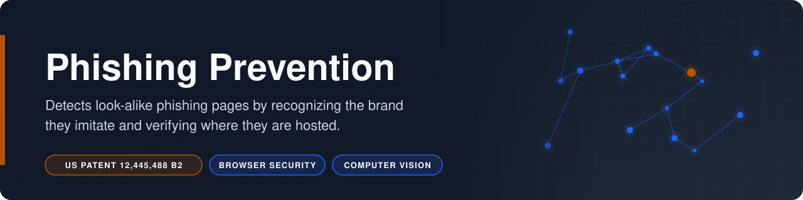
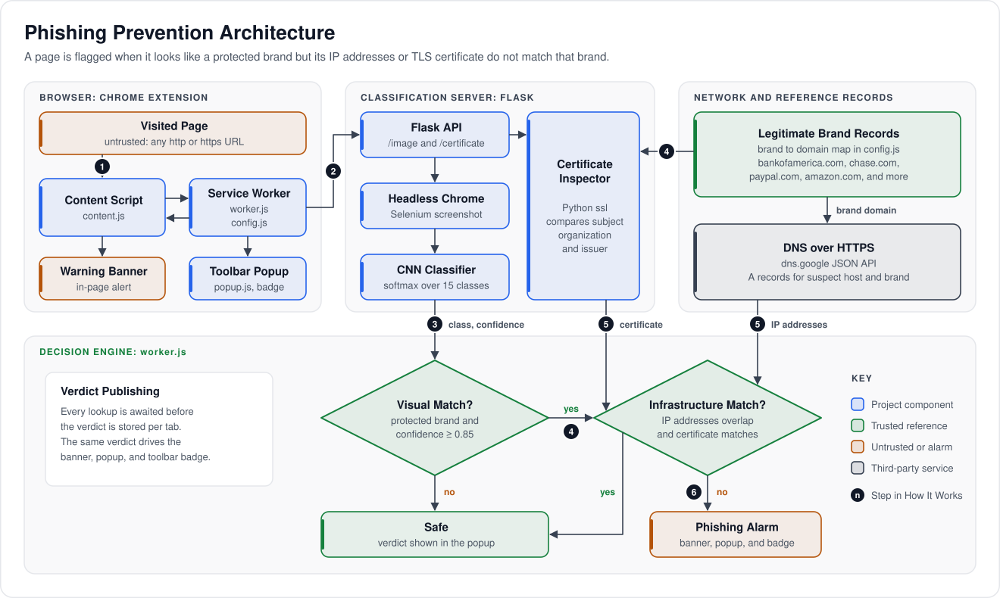
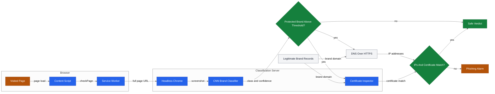
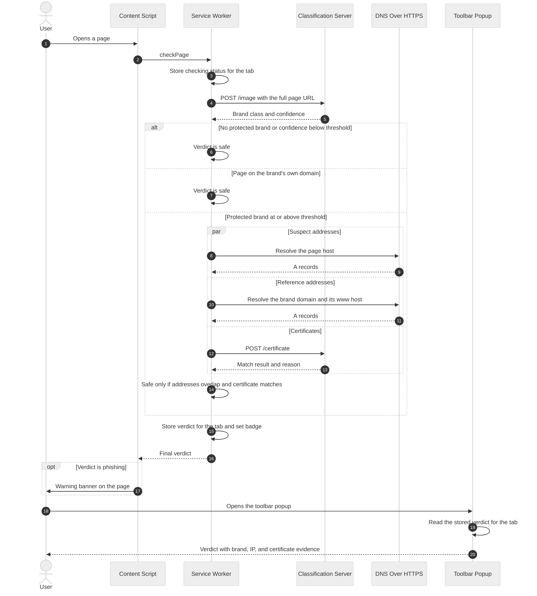

<p align="center"></p>

# Phishing Prevention

**Detects look-alike phishing pages by recognizing the brand they imitate and verifying where they are hosted.**

 [](https://patents.google.com/patent/US12445488B2/)    

Phishing Prevention is the reference implementation of U.S. Patent No. 12,445,488 B2. A Chrome extension and a self-hosted classification server work together to recognize when a page imitates one of 14 frequently impersonated brands, then verify the page's IP addresses and TLS certificate against that brand's real infrastructure. A cloned login page is flagged the moment it loads, even on a domain no blocklist has ever seen.

## Overview

Phishing Prevention judges a page by two independent identities: what it looks like and where it is served from. A convolutional neural network (CNN) recognizes the brand a page imitates from a screenshot. When the match is confident, the extension checks whether the page is hosted on that brand's infrastructure, and warns the user when it is not.

- **Visual brand recognition:** a CNN classifies a rendered screenshot into 14 brands or `other` and reports its softmax confidence.
- **Similarity threshold:** only matches at or above a configurable confidence (0.85 by default) trigger the infrastructure check.
- **Network identity check:** the page's resolved IP addresses must overlap the brand domain's addresses.
- **Certificate identity check:** the page's TLS certificate must carry the same subject organization and issuer as the brand's certificate.
- **Immediate warning:** a flagged page receives an in-page banner, a red toolbar badge, and a popup that lists the evidence.

## Business Case

### The Problem

An employee opens an invoice email, clicks the link, and lands on a pixel-perfect copy of the company's sign-in page, hosted on a domain registered that morning. No blocklist has seen the domain, the address looks plausible, and nothing on screen differs from the real page. One typed password can open the door to account takeover, payment fraud, ransomware, and the investigation, disclosure, and reputational costs that follow. Phishing kits make these clones cheap to produce at scale, so defenses that wait for a page to be reported are always one step behind.

### Who It Serves

- **Consumers and employees:** receive a clear warning at the moment an impersonating page loads, before any credential is typed.
- **Enterprise security teams:** stop zero-day credential harvesting pages across the workforce without waiting for threat feed updates.
- **Banks, payment providers, and high-risk brands:** protect customers from clones of their own sign-in pages wherever those clones are hosted.
- **Security vendors:** browser security, secure web gateway, email security, and managed security providers can license the method and embed it in existing products.

### The Outcome

- A page that looks like a protected brand but is not served from that brand's infrastructure is flagged on first sight, with no prior report, blocklist entry, or domain reputation required.
- The verdict rests on two signals that an attacker cannot fake together: a clone can copy every pixel of a bank's page, but it cannot be served from the bank's IP addresses or present the bank's certificate.
- Genuine brand pages pass, because their addresses and certificates match, so protection does not come at the cost of blocking the real site.
- The same decision engine deploys as a browser extension (this repository), a secure web gateway or endpoint agent service, an email link scanning stage, or a managed detection service.

### Market Applications

| Sector | Application | Value Delivered |
|---|---|---|
| Consumer security | Browser extension or built-in browser protection | Warns at page load, before credentials or card numbers are entered |
| Enterprise security | Secure web gateway or endpoint agent policy | Blocks newly registered credential harvesting pages across the workforce on first visit |
| Email security | Link detonation in a sandbox | Renders links before delivery and convicts brand impersonation with evidence |
| Banking and payments | Customer brand protection | Detects clones of the institution's own sign-in pages wherever they are hosted |
| Logistics and e-commerce | Delivery and order notification lures | Flags fake DHL, Amazon, and similar pages that ride on shipping and order emails |
| Managed security services | Security operations triage | Returns an automatic verdict with brand, IP, and certificate evidence for reported URLs |
| Threat intelligence | Phishing feed generation | Supplies confirmed phishing URLs to repositories such as PhishTank, OpenPhish, and Google Safe Browsing |

### Why This Approach

| Approach | How It Works | Weakness | This Project |
|---|---|---|---|
| URL blocklists | Match the address against lists of reported phishing URLs | Blind to new domains until someone reports them, which leaves a window of exposure | Judges the page itself, so no prior report is needed |
| URL and domain heuristics | Score lexical features, domain age, and look-alike spellings | Evaded by clean-looking domains and prone to false positives, as the patent background notes | Decides on visual identity and network identity instead of the address text |
| Visual similarity alone | Compare a screenshot with known brand pages | Cannot tell a clone from the original, so the brand's own pages are flagged too | Confirms each visual match against the brand's real IP addresses and certificate |
| User awareness training | Teach users to spot suspicious cues | A pixel-perfect clone on a plausible domain leaves nothing to spot | Checks automatically on every page load, with no user judgment required |

## Patent

The method implemented in this repository is protected by [U.S. Patent No. 12,445,488 B2](https://patents.google.com/patent/US12445488B2/).

| Field | Detail |
|---|---|
| Patent | [US 12,445,488 B2](https://patents.google.com/patent/US12445488B2/) |
| Title | Webpage phishing auto-detection |
| Inventors | Karthik Shourya Kaligotla |
| Filed | April 28, 2023 (application 18/309,240) |
| Granted | October 14, 2025 |
| Pre-grant publication | US 2023/0344868 A1 (October 26, 2023) |

**Claimed approach.** The method obtains a suspect link, captures an image of the page, and detects visual similarity to a pre-configured legitimate site labeled in a database, for example with a CNN. Only when similarity is found does it obtain the suspect site's IP address, digital certificate, or both, and compare them, statically or dynamically, with the legitimate site's records. An alarm is raised when they differ. Further claims cover a similarity threshold (85% to 99.9%) and a training pipeline that clusters and auto-labels screenshots and retrains the fully connected layer of a pre-trained CNN.

**Commercial application.** The method applies wherever a page can be rendered before the user trusts it:

- Browser security extensions and endpoint agents.
- Enterprise secure web gateways and network security appliances.
- Email security link detonation services.
- Brand protection services for banks, payment providers, and logistics companies.
- Threat intelligence feeds that report confirmed phishing sites to repositories such as PhishTank, OpenPhish, and Google Safe Browsing.

**Relationship to this code.** This repository implements the combined embodiment: image capture and CNN similarity with a configurable threshold, followed by both the IP address comparison and the certificate comparison against the legitimate brand's records, retrieved dynamically at check time. The patent additionally describes a screenshot clustering and retraining pipeline for the CNN.

**Patent notice.** No license under this patent is granted by this repository, expressly or by implication. For licensing inquiries, contact the author via [GitHub](https://github.com/risingOnIP).

## How It Works

Each page load runs a two-stage decision in the extension's service worker: first "does this page look like a protected brand?", then "is it served by that brand?".



1. **Page load:** `extension/content.js` runs in the top frame of every page and sends a `checkPage` message to the service worker.
2. **Visual classification:** `extension/worker.js` posts the full page URL to the `/image` route of `server/app.py`, which renders the page in headless Chrome and returns the CNN's brand class and softmax confidence.
3. **Similarity threshold:** the check continues only when the class is a protected brand in `extension/config.js` and the confidence is at or above `SIMILARITY_THRESHOLD`. Pages on the brand's own domain or its subdomains are accepted at this point.
4. **Reference records:** the brand map in `config.js` supplies the legitimate domain, for example `boa` to `bankofamerica.com` and `paypal` to `paypal.com`.
5. **Infrastructure comparison:** in parallel, the worker resolves A records for the page host and for the brand domain and its `www` host through DNS over HTTPS, and the server's `/certificate` route compares the page's TLS certificate with the brand's.
6. **Verdict:** the page is flagged when the IP address sets do not overlap or the certificates do not match. The worker stores the verdict for the tab, sets the toolbar badge, and returns it to `content.js`, which inserts the warning banner.
7. **Popup:** `extension/popup.html` and `extension/popup.js` show the verdict and its evidence for the active tab, with "Close Tab" and "Dismiss" buttons.

### Decision Rule

| Visual Match | IP Addresses Overlap | Certificate Matches | Verdict |
|---|---|---|---|
| No protected brand, or confidence below the threshold | Not checked | Not checked | Safe |
| Protected brand, page on the brand's own domain | Not checked | Not checked | Safe |
| Protected brand at or above the threshold | Yes | Yes | Safe |
| Protected brand at or above the threshold | No | Either | Phishing |
| Protected brand at or above the threshold | Either | No | Phishing |

A page served over plain HTTP presents no certificate, so it never matches a brand's certificate.

### Component Diagram



### Page Visit Sequence



## Tech Stack

| Layer | Technology | Purpose |
|---|---|---|
| Client | Chrome Extension, Manifest V3 (JavaScript) | Content script, service worker decision engine, and toolbar popup |
| Backend | Flask | HTTP API: `/image`, `/predict`, and `/certificate` |
| Tooling | Selenium with headless Chrome | Renders the visited page and captures a screenshot |
| Model | Keras CNN in TensorFlow.js format (`tensorflowjs`) | Classifies screenshots into 15 classes with softmax confidence |
| Data | Pillow and NumPy | Resizes and normalizes screenshots for inference |
| Network | Google DNS over HTTPS | Resolves A records for the page host and the brand domain |
| Network | Python `ssl` | Retrieves and verifies TLS certificates for comparison |

## Getting Started

### Prerequisites

- Google Chrome (desktop) to run the extension.
- Python 3.9 or later, in a version supported by TensorFlow, on the server host.
- Google Chrome on the server host for headless rendering. Selenium 4.6 or later downloads a matching ChromeDriver automatically.
- The trained weight files `group1-shard1of2.bin` and `group1-shard2of2.bin`, available from the author under license.

### Installation

1. Clone the repository.

   ```bash
   git clone https://github.com/risingOnIP/phishing-prevention.git
   cd phishing-prevention
   ```

2. Create a virtual environment for the server and install its dependencies.

   ```bash
   cd server
   python3 -m venv .venv
   source .venv/bin/activate
   pip install -r requirements.txt
   ```

3. Copy the two weight shards into `server/models/js/`, next to `model.json`.

   ```text
   server/models/js/
   ├── model.json
   ├── group1-shard1of2.bin
   └── group1-shard2of2.bin
   ```

4. Start the server. It listens on `http://127.0.0.1:5000` by default.

   ```bash
   python app.py
   ```

5. Load the extension: open `chrome://extensions`, turn on Developer mode, choose "Load unpacked", and select the `extension/` folder.

### Configuration

The server reads environment variables. The extension reads constants from `extension/config.js`; after editing that file, click the reload icon for the extension on `chrome://extensions`.

| Variable | Required | Description |
|---|---|---|
| `CHROME_BINARY` | No | Server. Chrome executable used by Selenium. Defaults to `/usr/bin/google-chrome`. |
| `MODEL_PATH` | No | Server. Path to `model.json`. Defaults to `models/js/model.json` next to `app.py`. |
| `HOST` | No | Server. Bind address. Defaults to `127.0.0.1`; set `0.0.0.0` to serve other machines. |
| `PORT` | No | Server. Listening port. Defaults to `5000`. |
| `SERVER_URL` | No | Extension, `config.js`. Base address of the classification server. Defaults to `http://localhost:5000`. |
| `SIMILARITY_THRESHOLD` | No | Extension, `config.js`. Minimum softmax confidence for a brand match. Defaults to `0.85`. |
| `PROTECTED_BRANDS` | No | Extension, `config.js`. Map from class name to brand name and legitimate domain. Covers the 14 named classes. |
| `DNS_RESOLVER_URL` | No | Extension, `config.js`. DNS over HTTPS JSON endpoint. Defaults to `https://dns.google/resolve`. |

To use a shared server, run it on a host reachable by the browsers it protects (preferably behind HTTPS) and set `SERVER_URL` to that address, for example `https://phishing-check.example.com`.

### Usage

Check that the server is running.

```bash
curl http://localhost:5000/
```

Classify a page by URL.

```bash
curl -X POST http://localhost:5000/image -H "Content-Type: application/json" -d '{"url": "https://www.example.com/login"}'
```

The response is `{"class": <brand class>, "confidence": <0 to 1>}`.

Compare a host's certificate with a brand domain's certificate.

```bash
curl -X POST http://localhost:5000/certificate -H "Content-Type: application/json" -d '{"hostname": "www.example.com", "domain": "paypal.com"}'
```

The response holds `match`, a `reason`, and the subject organization, common name, and issuer of both certificates.

In the browser, open any page and click the toolbar icon. The popup shows "You are safe." or "You are being phished." with the brand match, its confidence, and the IP and certificate results; a flagged page also shows a red warning banner and a "!" badge on the icon.

## Project Structure

```text
phishing-prevention/
├── docs/assets/
│   ├── architecture.svg     # Architecture schematic
│   └── banner.svg           # README banner
├── extension/
│   ├── manifest.json        # Manifest V3 configuration
│   ├── config.js            # Server URL, threshold, brand map
│   ├── worker.js            # Decision engine and verdict storage
│   ├── content.js           # Requests verdict, shows warning banner
│   ├── popup.html           # Toolbar popup layout
│   ├── popup.js             # Popup verdict, evidence, and buttons
│   └── Shield.png           # Extension icon and popup image
├── server/
│   ├── app.py               # Flask API, screenshots, CNN, certificates
│   ├── requirements.txt     # Python dependencies
│   └── models/js/
│       └── model.json       # CNN topology and weight manifest
├── LICENSE
├── NOTICE
└── README.md
```

## Notes

- Trained model weights are proprietary and are not distributed with this repository. Place the two weight shards in `server/models/js/` as described in [Installation](#installation).
- The extension sends the full URL of each visited web page to the configured classification server, and hostnames to the DNS over HTTPS resolver. Self-hosting the server keeps page URLs inside the organization's network.
- The certificate check verifies certificates against the server host's system trust store. A certificate that fails verification never matches.
- The extension requests access to all sites (`<all_urls>`) because every page load is evaluated.

## License

Copyright (c) 2023 Karthik Kaligotla. All rights reserved. The source is published for review and evaluation. See [LICENSE](LICENSE) and [NOTICE](NOTICE). The underlying method is protected by U.S. Patent No. 12,445,488 B2; no patent license is granted.

## Author

Developed by [Karthik Kaligotla](https://github.com/risingOnIP), named inventor on U.S. Patents [12,445,488 B2](https://patents.google.com/patent/US12445488B2/) and [12,598,158 B2](https://patents.google.com/patent/US12598158B2/).
