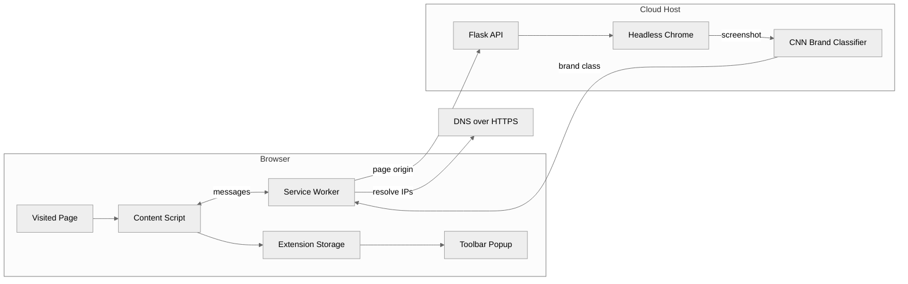

# Phishing Prevention

**Detects look-alike phishing pages by recognizing the brand they imitate and verifying where they are hosted.**

 [](https://patents.google.com/patent/US12445488B2/)    

Phishing Prevention is the reference prototype for U.S. Patent No. 12,445,488 B2. A Chrome extension sends each page it visits to a cloud service that screenshots the page and classifies it with a convolutional neural network (CNN) trained on 15 brand classes, then resolves the site's IP addresses for comparison with the legitimate brand's infrastructure. The goal is to flag a page that looks like a protected brand but is not served by that brand, even when the domain has never been seen before.

## Overview

The repository has two parts: a Manifest V3 Chrome extension (`extension/`) and a Flask inference service (`cloudHost/`). The extension gathers the page origin and its DNS records, asks the service which brand the page resembles, and shows the verdict in the toolbar popup. The service renders the page in headless Chrome and runs the screenshot through a Keras CNN stored in TensorFlow.js format.

- **Visual brand recognition:** a CNN classifies a 50 x 50 pixel screenshot into 14 commonly impersonated brands or `other`.
- **Network identity lookup:** the service worker resolves the visited site and the reference site (bankofamerica.com) through Google DNS-over-HTTPS.
- **In-browser verdict:** the toolbar popup reads the stored result and displays "You are safe." or "You are being phished.", with a button that closes the tab.

## Business Case

### The Problem

Phishing kits let attackers clone a bank or SaaS login page in minutes and host it on fresh domains. Blocklists and URL heuristics lag behind these zero-day pages, and a pixel-perfect clone defeats user vigilance. The patent background notes that filter and heuristic defenses are limited against zero-day phishing and suffer high false-positive rates.

### Who It Serves

- **Consumers and employees:** receive a warning at the moment they land on an impersonating page.
- **Banks and high-risk brands:** protect customers without waiting for domain takedowns.
- **Security vendors:** browser security, secure web gateways, email link scanners, and managed security providers can embed the method in existing products.

### The Outcome

A page that looks like a protected brand but is not served from that brand's infrastructure is flagged, even if the domain has never been seen before. The decision rests on two signals that attackers find hard to fake together: visual identity and network identity.

## Patent

The method implemented in this repository is protected by [U.S. Patent No. 12,445,488 B2](https://patents.google.com/patent/US12445488B2/).

| Field | Detail |
|---|---|
| Patent | [US 12,445,488 B2](https://patents.google.com/patent/US12445488B2/) |
| Title | Webpage phishing auto-detection |
| Inventors | Karthik Shourya Kaligotla |
| Filed | April 28, 2023 (application 18/309,240) |
| Granted | October 14, 2025 |
| Pre-grant publication | US 2023/0344868 A1 (October 26, 2023) |

**Claimed approach.** The method obtains a suspect link, captures an image of the page, and detects visual similarity to a pre-configured legitimate site labeled in a database, for example with a CNN. Only when similarity is found does it obtain the suspect site's IP address or digital certificate and compare it, statically or dynamically, with the legitimate site's records. An alarm is raised when they differ. Further variants cover the certificate check, a combined IP and certificate check, a similarity threshold, and a training pipeline that clusters and auto-labels screenshots and retrains the fully connected layer of a pre-trained CNN.

**Commercial application.** The method applies wherever a page can be rendered before the user trusts it:

- Browser security extensions and endpoint agents.
- Enterprise secure web gateways.
- Email security link-detonation services.
- Brand protection services for banks, payment providers, and logistics companies (the 15 trained classes cover frequently impersonated brands).
- Threat intelligence feeds that report confirmed phishing sites to repositories such as PhishTank, OpenPhish, and Google Safe Browsing.

**Relationship to this code.** This repository is a reference prototype of the image plus IP-comparison embodiment, with one protected brand (Bank of America) configured. The certificate comparison, the similarity threshold, and the retraining pipeline are not implemented, and the IP comparison step is not yet effective (see [Scope and Limitations](#scope-and-limitations)).

**Patent notice.** No license under this patent is granted by this repository, expressly or by implication. For licensing inquiries, contact the author via [GitHub](https://github.com/risingOnIP).

## How It Works

The content script collects the page origin, the predicted brand, and the site's IP addresses through the service worker, then stores a verdict that the toolbar popup displays.



1. **Origin:** on page load, `extension/content.js` sends `getURL`, and `extension/worker.js` returns the HTTPS origin of the tab.
2. **Classification:** `getClassification` posts `{"url": <origin>}` to the `/image` route of `cloudHost/app.py`.
3. **Screenshot:** `app.py` opens the origin in headless Chrome through Selenium, waits 3 seconds, and saves a screenshot.
4. **Inference:** the screenshot is resized to 50 x 50 pixels and classified by the CNN (two convolution and pooling stages, a 64-unit dense layer, and a 15-way softmax), and the class name is returned.
5. **Network identity:** `getIP` and `getValidationIP` resolve the visited site and bankofamerica.com through `https://dns.google/resolve` and return their A records.
6. **Verdict:** `content.js` writes `{url, ipString, ipArr, classification, isSafe}` to `chrome.storage.local`.
7. **Display:** `extension/popup.html` and `extension/animate.js` read `isSafe` and type out the verdict, with "Close Tab" and "Dismiss" buttons.

## Tech Stack

| Layer | Technology | Purpose |
|---|---|---|
| Client | Chrome Extension, Manifest V3 (JavaScript) | Content script, service worker, and toolbar popup |
| Network | Google DNS-over-HTTPS | Resolves A records for the visited and reference sites |
| Backend | Flask | HTTP API for classification (`/image`, `/predict`) |
| Tooling | Selenium with headless Chrome | Renders the page and captures a screenshot |
| Model | Keras CNN in TensorFlow.js format (`tensorflowjs`) | Classifies screenshots into 15 brand classes |
| Data | Pillow and NumPy | Resizes and normalizes screenshots for inference |

## Getting Started

### Prerequisites

- Google Chrome, for loading the unpacked extension.
- Python 3.9 or later, in a version supported by TensorFlow, on the server host.
- Google Chrome installed on the server host for headless rendering.
- The model weight files `group1-shard1of2.bin` and `group1-shard2of2.bin` (not distributed in this repository).

### Installation

1. Clone the repository.

   ```bash
   git clone https://github.com/risingOnIP/phishingPrevention.git
   cd phishingPrevention
   ```

2. Create a virtual environment for the cloud host and install its dependencies.

   ```bash
   cd cloudHost
   python3 -m venv .venv
   source .venv/bin/activate
   pip install -r requirements.txt
   ```

3. Copy the two weight shards into `cloudHost/models/js/`, next to `model.json`.

4. Load the extension: open `chrome://extensions`, turn on Developer mode, choose "Load unpacked", and select the `extension/` folder.

### Configuration

| Variable | Required | Description |
|---|---|---|
| `CHROME_BINARY` | No | Path to the Chrome executable used by Selenium in `cloudHost/app.py`. Defaults to `/usr/bin/google-chrome`. |
| `CLASSIFIER_API_URL` | No | Constant in `extension/worker.js` that holds the classifier endpoint. Point it at a self-hosted `/image` route, for example `http://127.0.0.1:5000/image`. |

### Usage

Start the inference service from the `cloudHost/` folder (the model path is relative to the working directory).

```bash
python app.py
```

Check the service with a sample request.

```bash
curl -X POST http://127.0.0.1:5000/image -H "Content-Type: application/json" -d '{"url": "https://www.example.com"}'
```

The service responds with the predicted class name as a JSON string. In the browser, open an HTTPS page, wait a few seconds for the checks to finish, and click the toolbar icon to see the verdict.

## Project Structure

```text
phishingPrevention/
├── cloudHost/
│   ├── app.py              # Flask API, screenshot, and CNN inference
│   ├── requirements.txt    # Python dependencies
│   └── models/js/
│       └── model.json      # CNN topology and weight manifest
├── extension/
│   ├── manifest.json       # Manifest V3 configuration
│   ├── content.js          # Per-page checks and stored verdict
│   ├── worker.js           # Service worker message handlers
│   ├── popup.html          # Toolbar popup layout
│   ├── animate.js          # Popup verdict text and buttons
│   └── Shield.png          # Extension icon and popup image
├── LICENSE
├── NOTICE
└── README.md
```

## Scope and Limitations

- The current build protects one configured brand (Bank of America, class `boa`), with bankofamerica.com as the reference site.
- The IP lookup runs for every page, not only for pages classified as the protected brand, because of a debug override in `content.js`.
- The comparison between the visited site's addresses and the reference addresses is not yet effective: it compares message objects and is read before the reference lookup completes. As a result, the stored verdict currently follows the classifier alone, so any page classified as `boa` is marked unsafe, including the genuine bankofamerica.com.
- The in-page red banner and alert in `content.js` are evaluated before the asynchronous checks finish, so the toolbar popup is the only place the verdict appears.
- The verdict is stored as a single value, so the popup reflects the most recently evaluated page rather than a specific tab. Before any page has been evaluated, the popup shows the unsafe message.
- Only HTTPS pages are evaluated, and the classifier receives the origin (`https://host`) rather than the full page URL.
- The DNS lookup removes the first hostname label (for example `www.`), which assumes the site is visited through a subdomain.
- In `worker.js`, a DNS error response is reported to the content script, but processing continues and can raise an error.
- Model weights are not distributed in this repository, so `app.py` cannot load the model from a fresh clone without the two weight shards.
- The audible alarm file (`siren.wav`) is not included. `manifest.json` lists `models/js/*` as a web accessible resource, but that folder does not exist under `extension/`.
- The cloud host writes every screenshot to the same file (`python.png`), so concurrent `/image` requests can overwrite each other. Dependency versions are minimums, not pins.
- The extension requests access to all sites (`<all_urls>`) and runs on every page, which this use case requires. Each evaluated origin is sent to the classifier service, and its hostname is sent to Google DNS.
- The hosted classifier endpoint configured in `worker.js` may not be available; a self-hosted instance of `cloudHost/` can be used instead.

## Roadmap

- [ ] Compare resolved address sets after both lookups complete, and show the in-page banner from that verdict.
- [ ] Extend protection from Bank of America to the other 13 named brand classes with a brand-to-domain map.
- [ ] Send the full page URL to the classifier and use a unique temporary file per screenshot.
- [ ] Add the certificate comparison embodiment, alone and combined with the IP check.
- [ ] Add the similarity threshold and the screenshot clustering and retraining pipeline described in the patent.

## License

Copyright (c) 2023 Karthik Kaligotla. All rights reserved. The source is published for review and evaluation. See [LICENSE](LICENSE) and [NOTICE](NOTICE). The underlying method is protected by U.S. Patent No. 12,445,488 B2; no patent license is granted.

## Author

Developed by [Karthik Kaligotla](https://github.com/risingOnIP), named inventor on U.S. Patents [12,445,488 B2](https://patents.google.com/patent/US12445488B2/) and [12,598,158 B2](https://patents.google.com/patent/US12598158B2/).
